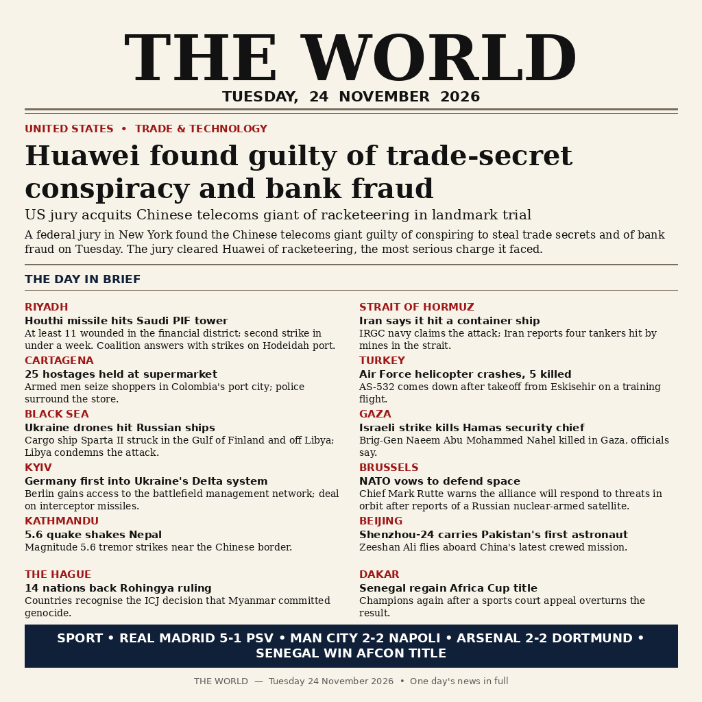

[](https://make.fun/bounty/news-image-20261124)
[](https://make.fun/bounty/news-image-20261124)
[](https://make.fun/bounty/news-image-20261124)

# The World — Tuesday 24 November 2026

One image that sums up the world's news of Tuesday 24 November 2026, drawn as
the front page of a newspaper. The lead is the US jury's verdict on Huawei —
guilty of trade-secret conspiracy and bank fraud, acquitted of racketeering —
followed by the day's other big stories: the Houthi missile strike on the
Saudi PIF tower in Riyadh, the container-ship attack in the Strait of Hormuz,
25 hostages held at a supermarket in Cartagena, the Turkish helicopter crash,
Ukraine's drone strikes on Russian ships, Senegal regaining the Africa Cup of
Nations title, and a sports strip with the night's Champions League results.



## How it is made

`render.py` draws the whole front page with Python and Pillow — every headline
and paragraph is placed by the script, so the image is fully deterministic and
contains no generated or borrowed artwork. `main.ts` simply copies the
rendered `entry.png` to the output directory and checks the copy by SHA-256.

## Run it

```sh
python3 render.py            # re-render entry.png (deterministic)
mkdir -p out && MAKEFUN_OUTPUT_DIR=out node main.ts
```
